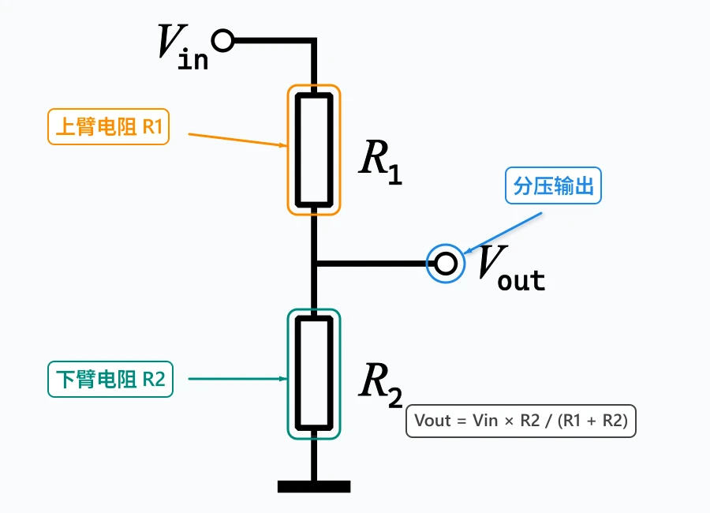
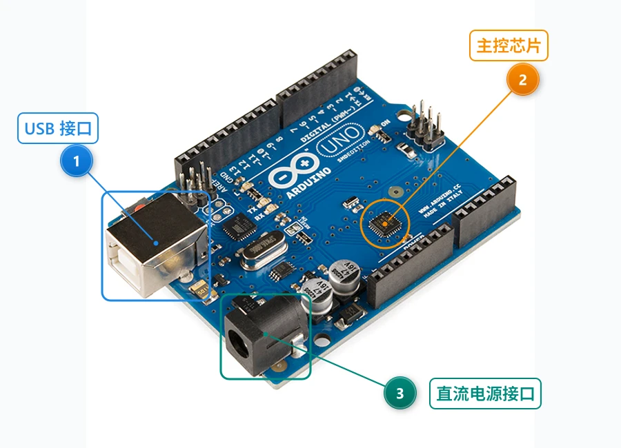
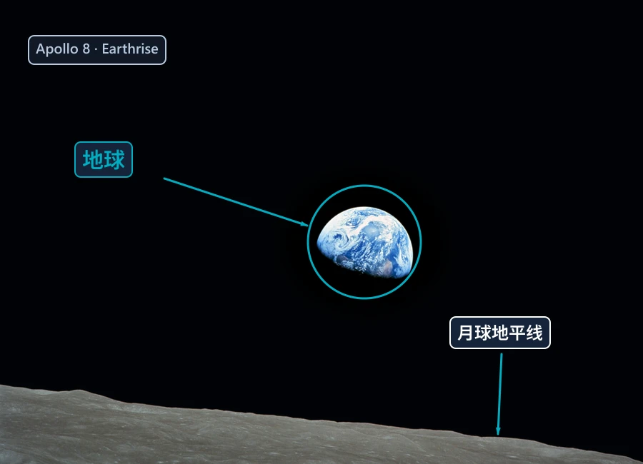

# Image Annotator MCP · 图片标注助手

[中文](README.md) | English · **v1.5.0**

Let AI add arrows, numbers, labels, highlights, callouts, and blur to images. Supports local files, Cherry Studio chat images, and local image URLs for Markdown replies.


## Quick start

Requires **Node.js 18+**.

```bash
git clone https://github.com/leezehuan/image-annotator-mcp.git
cd image-annotator-mcp
npm ci
```

Add a **stdio** MCP server, replacing the path with your local `server.js`:

```json
{
  "mcpServers": {
    "image-annotator": {
      "command": "node",
      "args": ["/absolute/path/to/image-annotator-mcp/server.js"]
    }
  }
}
```

Enable the tools in your client. Restart the MCP server after updating; no build step is required.

## Use it

> Annotate this image with image-annotator. If no file path is available, use list_cherry_images to match the preview, then save_attached_image. Copy the generated image Markdown unchanged into your final reply.

- Match Cherry cache previews with a vision-capable model; cached images may belong to different chats.
- Local images need an absolute path. Coordinates use original image pixels.
- Outputs include the saved path, image content, local HTTP URL, and Markdown. URLs last up to 24 hours and expire when the MCP server stops or restarts.
- Cherry Studio 2.1.8 inline HTTP rendering still awaits UI verification. Expand the tool response if needed, and save important temporary outputs elsewhere.

## Real examples

Generated using this project's `annotate_screenshot` tool.

**Circuit explanations: Chinese labels, arrows, and a divider formula**



**Hardware guides: numbered markers, leader lines, and highlights**



**Photo annotations: spotlight, circles, and labels**



Sources: Wikimedia Commons. Divider diagram: public domain. Arduino photo: © SparkFun Electronics, CC BY 2.0. Earthrise: NASA / Bill Anders, public domain. All three are modified; see [credits and licenses](examples/SOURCES.md). Rebuild with `node examples/generate-gallery.js`.

## Tools and documentation

| Purpose | Tools |
|---|---|
| Discover and save chat images | `list_cherry_images`, `save_attached_image` |
| Annotate, guide, and highlight | `annotate_screenshot`, `create_step_guide`, `highlight_area` |
| Callout, blur, and frame | `add_callout`, `blur_area`, `frame_screenshot` |
| Check original dimensions | `get_image_dimensions` |

[Chinese guide](docs/USAGE.zh-CN.md) · [Full reference](docs/REFERENCE.en.md) · [Cookbook](USAGE.md) · [Issues](https://github.com/leezehuan/image-annotator-mcp/issues)

MIT license. Based on [Varun Dubey's original project](https://github.com/vapvarun/image-annotator-mcp). Third-party sample images retain their own licenses.
