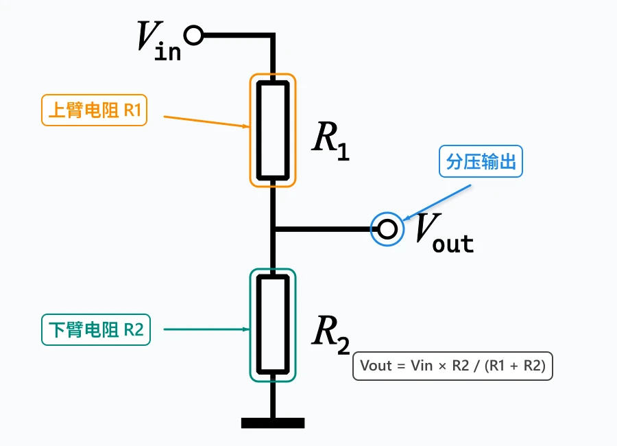
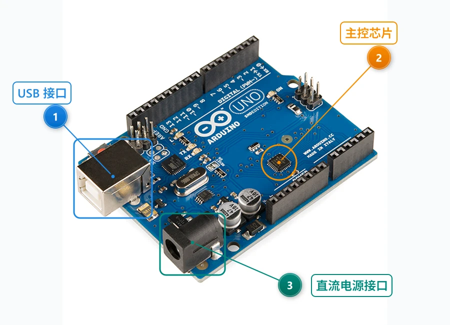
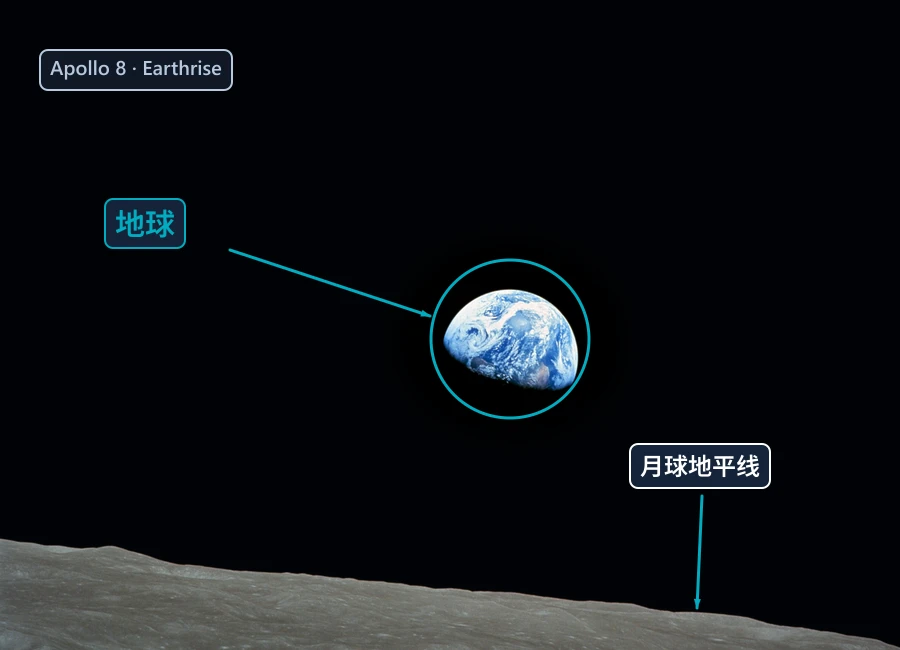

# Image Annotator MCP

中文 | [English](README.en.md) · **v1.5.0**

让 AI 为图片添加中文说明、箭头、编号、框选、高亮和模糊。支持本地图片、Cherry Studio 聊天附件，以及可嵌入回复正文的本机图片 URL。


## 安装与配置

需要 **Node.js 18+**。

```bash
git clone https://github.com/leezehuan/image-annotator-mcp.git
cd image-annotator-mcp
npm ci
```

在 Cherry Studio 或其他 MCP 客户端添加 **stdio** 服务，将参数替换为本机 `server.js` 的绝对路径：

```json
{
  "mcpServers": {
    "image-annotator": {
      "command": "node",
      "args": ["D:\\Project\\image-annotator-mcp\\server.js"]
    }
  }
}
```

保存后启用工具。更新代码后重启此 MCP 即可，无需构建。

## 怎么用

发送图片后，可以直接说：

> 请用 image-annotator 标注这张图。如果没有文件路径，先用 list_cherry_images 匹配预览，再用 save_attached_image 保存。将生成工具返回的图片 Markdown 原样放进回复正文。

- **聊天附件**：支持视觉的模型需对照预览选择图片，缓存可能来自不同对话。
- **本地图片**：提供绝对路径即可；标注坐标使用原图像素。
- **查看结果**：工具返回保存路径、图片、HTTP URL 和 Markdown。本机 URL 最长有效 24 小时，MCP 停止或重启后失效。
- **Cherry Studio 2.1.8**：正文 HTTP 图片仍待界面验证；若未显示，可展开工具响应查看。临时目录中的重要结果请另存。

## 实际样本

以下图片均由本项目的 `annotate_screenshot` 工具生成。

**电路讲解：中文标签、箭头与分压公式**



**器件定位：编号、引导线与框选**



**照片标注：聚光灯、圆圈与重点说明**



素材来自 Wikimedia Commons：分压图为公有领域；Arduino 照片 © SparkFun Electronics，CC BY 2.0；地出照片为 NASA / Bill Anders 的公有领域作品。均已修改，完整出处与授权见 [图片来源](examples/SOURCES.md)。复现样本：`node examples/generate-gallery.js`。

## 工具与文档

| 用途 | 工具 |
|---|---|
| 找到并保存聊天图片 | `list_cherry_images`、`save_attached_image` |
| 组合标注、步骤与高亮 | `annotate_screenshot`、`create_step_guide`、`highlight_area` |
| 说明框、模糊与外框 | `add_callout`、`blur_area`、`frame_screenshot` |
| 查询原图尺寸 | `get_image_dimensions` |

[中文详细指南](docs/USAGE.zh-CN.md) · [参数参考](docs/REFERENCE.en.md) · [使用配方](USAGE.md) · [问题反馈](https://github.com/leezehuan/image-annotator-mcp/issues)

MIT 许可证，基于 [Varun Dubey 的原项目](https://github.com/vapvarun/image-annotator-mcp) 开发。第三方示例图片授权见各自来源。
